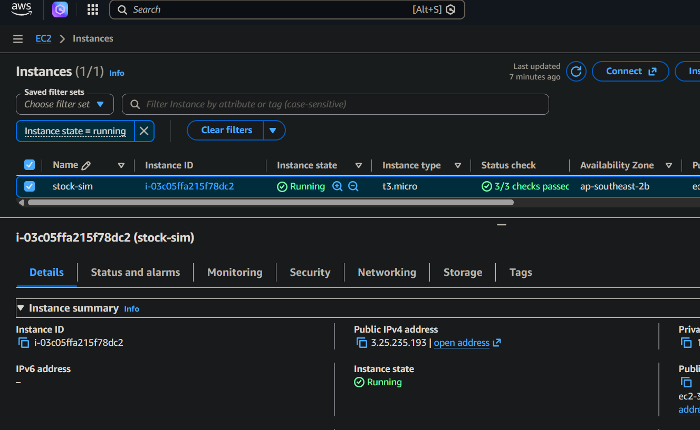
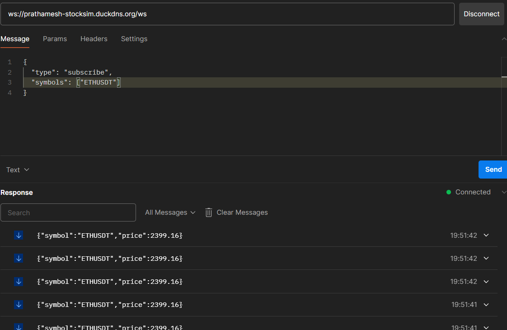
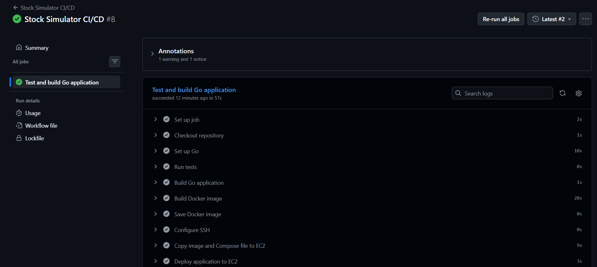

<div align="center">

# 📈 Stock Simulator

**A production-style, real-time market data streaming server**

*Built with Go · WebSockets · Redis Pub/Sub · Binance Streams*

<br/>

[](https://go.dev/)
[](https://redis.io/)
[](https://www.docker.com/)
[](https://binance.com/)
[](https://aws.amazon.com/)
[](https://github.com/prathamesh1301/Stock-Simulator/actions/workflows/deploy.yml)

<br/>

> WebSocket clients subscribe to crypto symbols and receive **live market updates** with automatic feed management, reconnection handling, metrics, and horizontal scalability.

</div>

---

## ✨ Features

<table>
<tr>
<td width="50%">

### 📡 Real-Time Market Data
- Live prices from Binance WebSocket streams
- Dynamic symbol subscriptions & unsubscriptions
- Feed activates **only when a client is listening**

### 🔌 WebSocket Server
- Multiple concurrent clients
- Per-client subscriptions
- Heartbeat ping/pong support
- Stale connection cleanup & backpressure protection

### 🔴 Redis Pub/Sub
- Decouples ingestion from delivery
- Enables **horizontal scaling**
- Multiple WS server instances share the same feed

</td>
<td width="50%">

### 🎛️ Feed Management
- Tracks active symbol counts
- Auto-subscribes to Binance on first client
- Auto-unsubscribes when last client leaves
- Prevents unnecessary Binance traffic

### 🛡️ Reliability
- Automatic Binance reconnection
- Stream re-subscription after reconnect
- Graceful shutdown (SIGINT/SIGTERM)
- Context-based cancellation

### 📊 Observability
- Connected clients, active symbols
- Messages received / sent totals
- Binance reconnect counter
- Top subscribed symbols

</td>
</tr>
</table>

---

## 🏗️ Architecture

```
                       ┌──────────────────┐
                       │ Binance WS Feed  │
                       └─────────┬────────┘
                                 │  live trade stream
                                 ▼
                 ┌────────────────────────────┐
                 │  Binance Ingestion Service │
                 │                            │
                 │  · Dynamic Feed Management │
                 │  · Reconnection Logic      │
                 └─────────────┬──────────────┘
                               │  publish
                               ▼
                      Redis Pub/Sub Channel
                               │  subscribe
                               ▼
                 ┌───────────────────────────┐
                 │       Redis Subscriber    │
                 └─────────────┬─────────────┘
                               │  broadcast
                               ▼
                 ┌───────────────────────────┐
                 │            Hub            │
                 │  · Register / Unregister  │
                 │  · Broadcast Events       │
                 │  · Symbol Tracking        │
                 └────────┬──────────┬───────┘
                          │          │
                          ▼          ▼
                      Client A    Client B
                      BTCUSDT     ETHUSDT
```

---

## 📦 Project Structure

```
stock-sim/
├── cmd/
│   └── main.go                  # Entry point
│
├── internal/
│   ├── domain/
│   │   ├── binance.go
│   │   ├── client.go
│   │   ├── feed_command.go
│   │   ├── market_event.go
│   │   ├── stock.go
│   │   └── subscription.go
│   │
│   ├── hub/
│   │   └── hub.go               # Client registration & broadcasting
│   │
│   ├── market/
│   │   ├── binance.go           # Binance WS ingestion
│   │   └── subscriber.go        # Redis subscriber
│   │
│   ├── metrics/
│   │   └── metrics.go           # Custom HTTP metrics
│   │
│   ├── redis/
│   │   └── client.go            # Redis client wrapper
│   │
│   └── websocket/
│       └── pumps.go             # Read/write pumps per client
│
├── Dockerfile
├── docker-compose.yml
├── .env
└── README.md
```

---

## 🔄 Event Flow

### Client Subscription

```
Client  ──►  WebSocket  ──►  Hub
                               │
                    SymbolCount == 1?
                               │
                               └──►  FeedCommand(subscribe)  ──►  Binance Feed
```

### Market Data Flow

```
Binance  ──►  Ingestion Service  ──►  Redis Publish
                                            │
                                      Redis Subscribe
                                            │
                                           Hub
                                            │
                                    Subscribed Clients
```

---

## 🔌 WebSocket API

### Connect

| Environment | URL |
|-------------|-----|
| Local | `ws://localhost:8080/ws` |
| Production (HTTPS) | `wss://your-domain/ws` |

### Subscribe

```json
{
  "type": "subscribe",
  "symbol": ["BTCUSDT", "ETHUSDT"]
}
```

### Unsubscribe

```json
{
  "type": "unsubscribe",
  "symbol": ["ETHUSDT"]
}
```

### Market Update (Server → Client)

```json
{
  "symbol": "BTCUSDT",
  "price": 63542.12
}
```

---

## 📊 Metrics

```
GET /metrics
```

**Example Response:**

```json
{
  "active_symbols": 2,
  "binance_reconnects_total": 0,
  "connected_clients": 5,
  "messages_received_total": 1245,
  "messages_sent_total": 9860,
  "top_symbols": [
    { "symbol": "BTCUSDT", "count": 3 },
    { "symbol": "ETHUSDT", "count": 2 }
  ]
}
```

---

## ⚡ Load Testing & Performance

The Stock Simulator is optimized for high concurrency and has been load-tested with **10,000 concurrent WebSocket clients** to verify message delivery and system stability under high-throughput conditions.

### Load Test Overview
- **Concurrently Connected Clients**: 10,000
- **Subscription**: Every client successfully subscribes to the live `BTCUSDT` stream.
- **Heartbeat & Connection Management**: Keeps connections active without drops, responding to server-initiated pings within the timeout threshold.
- **Implementation**: Driven by the custom load-test script in [internal/test/load.go](internal/test/load.go).

### Performance Video

A visualization of the WebSocket load test running against the dashboard:

https://github.com/user-attachments/assets/51e98b1c-ec1f-4dd5-970f-045538380f52

---

## ⚙️ Configuration

| Variable | Default | Description |
|----------|---------|-------------|
| `PORT` | `8080` | HTTP/WS server port |
| `REDIS_ADDR` | `localhost:6379` | Redis connection address |

**AWS example:**

```env
REDIS_ADDR=<aws-redis-host>:6379
```

---

## 🐳 Running with Docker

```bash
# Build the images
docker compose build

# Start services
docker compose up
```

> Redis and the Go server both start automatically via Docker Compose.

---

## 🧪 Local Development

```bash
# Install dependencies
go mod tidy

# Start the server
go run ./cmd/main.go
```

| Endpoint | URL |
|----------|-----|
| Server | `http://localhost:8080` |
| Metrics | `http://localhost:8080/metrics` |
| WebSocket | `ws://localhost:8080/ws` |

---

## ☁️ Deploying to AWS EC2

The project runs on a single EC2 instance: Docker Compose runs the Go server and Redis, and Nginx sits in front to handle public traffic and the WebSocket upgrade.

```
 Client (Postman / browser / wscat)
        │   ws://<EC2_PUBLIC_IP>/ws
        ▼
 AWS Security Group  ── allows 22 (my IP only), 80, 443
        ▼
 Nginx (port 80/443)  ── proxies HTTP + WebSocket upgrade
        ▼
 stock-sim container  (127.0.0.1:8080, not public)
        ▼
 redispubsub container (internal Docker network only, not public)
        ▼
 Binance WebSocket stream (outbound)
```

### ✅ Deployment proof

**Stock Simulator running on an AWS EC2 instance:**

<div align="center">

</div>

**Postman WebSocket client connected to the deployed server:**

<div align="center">

</div>

### Requirements

| Item | Choice | Notes |
|------|--------|-------|
| Region | A region where Binance is reachable (e.g. Mumbai `ap-south-1`) | Binance blocks some countries, such as the US |
| OS | Ubuntu Server LTS | |
| Instance | `t3.micro` (demo) | 1 GB RAM: add swap before building (see step 5) |
| Disk | 16 GB recommended | Docker images use several GB |
| Key pair | RSA `.pem` | Keep it private |

**Security group rules**

| Port | Source | Purpose |
|------|--------|---------|
| 22 | My IP | SSH administration |
| 80 | Anywhere (`0.0.0.0/0`) | HTTP and WebSocket through Nginx |
| 443 | Anywhere (`0.0.0.0/0`) | HTTPS / `wss://` (optional) |
| 6379, 8080 | *not opened* | Redis and the app stay private |

> Never open 6379 to the internet. An exposed Redis server with no password gets attacked quickly.

### Step 1: Connect to the server

```bash
ssh -i your-key.pem ubuntu@<EC2_PUBLIC_IP>
```

The public IP changes every time the instance is stopped and started, so copy the current one from the EC2 console.

### Step 2: Install Docker and Git

```bash
sudo apt update
sudo apt install -y docker.io docker-compose-v2 git
sudo usermod -aG docker ubuntu
exit
```

Reconnect with SSH so the Docker group change takes effect.

### Step 3: Get the code

```bash
git clone https://github.com/prathamesh1301/Stock-Simulator.git
cd Stock-Simulator
touch .env
```

### Step 4: Use the production compose file

The default `docker-compose.yaml` publishes Redis on port 6379. For the server, replace it so Redis stays on the internal Docker network, the app is reachable only by Nginx, and containers restart automatically:

```bash
cat > docker-compose.yaml <<'EOF'
services:
  redis:
    image: redis:7-alpine
    container_name: redispubsub
    restart: unless-stopped

  app:
    build: .
    container_name: stock-sim
    env_file:
      - .env
    environment:
      - REDIS_ADDR=redispubsub:6379
    ports:
      - "127.0.0.1:8080:8080"
    depends_on:
      - redis
    restart: unless-stopped
EOF
```

| Change | Reason |
|--------|--------|
| No `ports` on Redis | The app reaches it as `redispubsub:6379` inside Docker; nothing public needs it |
| `127.0.0.1:8080:8080` | Only Nginx on the same machine can reach the app |
| `restart: unless-stopped` | Containers come back after a crash or reboot |
| `redis:7-alpine` | Pinned version instead of `latest` |

### Step 5: Add swap, then build and start

The Go compiler can be killed on a 1 GB instance (`signal: killed`). A swap file prevents that:

```bash
sudo fallocate -l 2G /swapfile
sudo chmod 600 /swapfile
sudo mkswap /swapfile
sudo swapon /swapfile
free -h
```

Check that Binance is reachable from the server, then start everything:

```bash
curl -s https://api.binance.com/api/v3/ping     # should print {}
docker compose up -d --build
docker compose ps                                # both containers running
curl http://localhost:8080/metrics               # metrics JSON
```

### Step 6: Put Nginx in front (with WebSocket support)

```bash
sudo apt install -y nginx
sudo rm -f /etc/nginx/sites-enabled/default
sudo tee /etc/nginx/conf.d/stock-sim.conf > /dev/null <<'EOF'
server {
    listen 80;
    server_name _;

    location / {
        proxy_pass http://127.0.0.1:8080;
        proxy_http_version 1.1;
        proxy_set_header Upgrade $http_upgrade;
        proxy_set_header Connection "upgrade";
        proxy_set_header Host $host;
        proxy_set_header X-Real-IP $remote_addr;
        proxy_set_header X-Forwarded-For $proxy_add_x_forwarded_for;
        proxy_read_timeout 3600s;
        proxy_send_timeout 3600s;
    }
}
EOF
sudo nginx -t
sudo systemctl reload nginx
```

The `Upgrade` and `Connection` headers let the WebSocket handshake pass through, and the long timeouts stop Nginx from closing idle connections after 60 seconds.

### Step 7: Test the WebSocket

Use the public address with **no port number**:

| Check | Address |
|-------|---------|
| Metrics | `http://<EC2_PUBLIC_IP>/metrics` |
| WebSocket | `ws://<EC2_PUBLIC_IP>/ws` |

**With Postman:** New → WebSocket → enter `ws://<EC2_PUBLIC_IP>/ws` → Connect → send:

```json
{ "type": "subscribe", "symbol": ["BTCUSDT", "ETHUSDT"] }
```

**With wscat:**

```bash
npm install -g wscat
wscat -c ws://<EC2_PUBLIC_IP>/ws
```

Live `{"symbol": "...", "price": ...}` messages should start arriving (see the Postman screenshot above).

### Optional: domain and HTTPS

Point a domain (for example a free DuckDNS name) at the instance, set it as `server_name` in the Nginx config, then:

```bash
sudo apt install -y certbot python3-certbot-nginx
sudo certbot --nginx -d your-domain
```

Clients then connect with `wss://your-domain/ws`. Open port 443 in the security group first.

### Operating the deployment

| Task | Command (run in the project folder) |
|------|-------------------------------------|
| View app logs | `docker compose logs -f app` |
| Deploy an update | Push to `main` — GitHub Actions handles the rest automatically |
| Restart | `docker compose restart` |
| Stop everything | `docker compose down` |
| Free disk space | `docker image prune -f` |

### Troubleshooting

| Symptom | Likely cause and fix |
|---------|----------------------|
| `signal: killed` during build | Out of memory: add the swap file from step 5, or build on a larger instance |
| `env file .env not found` | Run `touch .env` in the project folder |
| `docker: permission denied` | Reconnect over SSH after the `usermod` command |
| `/metrics` works on the server but times out from outside | Port 80 is missing from the security group, or the public IP changed |
| WebSocket connects, then drops after about a minute | The Nginx `Upgrade` headers or `proxy_read_timeout` are missing |
| Connected but no prices | Check `docker compose logs app` for Binance errors, such as a region block |
| `502 Bad Gateway` | The containers are not running: check `docker compose ps` |

### Cost notes

- Stop the instance when you are not using it. The public IP changes on restart, and the containers start again on their own.
- Terminating the instance deletes its disk. Redis holds only live pub/sub traffic, so nothing important is lost.

---

## 🚀 CI/CD Pipeline

Every push to `main` automatically tests, builds, and deploys the application to the AWS EC2 instance via GitHub Actions — no manual steps required.

### ✅ Pipeline proof

The badge below reflects the **live status** of the last workflow run directly from GitHub Actions:

[](https://github.com/prathamesh1301/Stock-Simulator/actions/workflows/deploy.yml)

Click the badge to open the full run history, logs, and per-step output.

**GitHub Actions run — all steps passing:**

<div align="center">

</div>

### Pipeline overview

```
  git push → main
        │
        ▼
  ┌─────────────────────────────────────────┐
  │          GitHub Actions Runner          │
  │                                         │
  │  1. go test ./...          (all tests)  │
  │  2. go build ./...         (compile)    │
  │  3. docker build           (image)      │
  │  4. docker save → .tar     (export)     │
  │  5. SSH → copy .tar + compose to EC2   │
  │  6. SSH → docker load + compose up     │
  └─────────────────────────────────────────┘
        │
        ▼
  EC2: new container running, old one replaced
```

### Trigger conditions

| Event | Test & Build | Deploy to EC2 |
|-------|:------------:|:--------------:|
| Push to `main` | ✅ | ✅ |
| Pull request to `main` | ✅ | ❌ |
| Manual (`workflow_dispatch`) | ✅ | ✅ |

> Pull requests only run tests and build — they never touch the live server.

### Pipeline stages

| Step | What it does |
|------|--------------|
| **Checkout** | Pulls the repository code |
| **Set up Go** | Installs the Go version from `go.mod`, with module cache |
| **Run tests** | `go test ./...` — fails fast if any test breaks |
| **Build Go app** | `go build ./...` — validates the binary compiles cleanly |
| **Build Docker image** | Builds `stock-simulator-app:latest` from the `Dockerfile` |
| **Save image** | `docker save` exports the image to a `.tar` archive |
| **Configure SSH** | Writes the private key and `known_hosts` from GitHub Secrets |
| **Copy to EC2** | Streams the `.tar` and `docker-compose.yaml` to the instance over SSH |
| **Deploy** | `docker load` + `docker compose up -d --no-build --force-recreate app` |

### Required GitHub Secrets & Variables

Set these in **Settings → Secrets and variables → Actions** before the first run.

| Name | Type | Description |
|------|------|-------------|
| `EC2_SSH_PRIVATE_KEY` | Secret | Private key (ed25519 `.pem`) used to SSH into the instance |
| `EC2_KNOWN_HOSTS` | Secret | Output of `ssh-keyscan <EC2_PUBLIC_IP>` — prevents MITM |
| `EC2_HOST` | Secret | Public IP or DNS of the EC2 instance |
| `EC2_USER` | Variable | SSH username (e.g. `ubuntu`) |
| `EC2_APP_DIR` | Variable | Absolute path to the project folder on EC2 (e.g. `/home/ubuntu/Stock-Simulator`) |

### How the deploy works (no build on EC2)

The Docker image is built entirely on the GitHub Actions runner and shipped to EC2 as a `.tar` file. The EC2 instance only needs to:

1. `docker load` the pre-built image
2. `docker compose up -d --no-build --force-recreate app`

This means the instance never needs Go, Git, or enough RAM to compile — making `t3.micro` (1 GB) a viable production target.

---

## 🔐 Reliability

### Binance Reconnection

If the Binance connection drops:

1. Reconnect automatically
2. Restore the WebSocket connection
3. Re-subscribe to all active symbols
4. Continue streaming — **zero server restarts needed**

### Graceful Shutdown

On `SIGINT` / `SIGTERM`:

1. Stop accepting new requests
2. Cancel background goroutines
3. Close WebSocket connections
4. Close Redis connections
5. Exit cleanly ✅

---

## 🛠️ Tech Stack

| Layer | Technology |
|-------|------------|
| 🐹 Language | Go |
| 🔌 WebSockets | Gorilla WebSocket |
| 📈 Market Data | Binance Streams |
| 📨 Message Broker | Redis Pub/Sub |
| ⚡ Concurrency | Goroutines + Channels |
| 🐳 Containerization | Docker |
| ☁️ Deployment | AWS EC2 |
| 🔄 CI/CD | GitHub Actions |
| 📊 Metrics | Custom HTTP Metrics |

---

<div align="center">

Built to learn and demonstrate **real-world event-driven backend architecture** using Go.

*⭐ Star this repo if you found it helpful!*

</div>